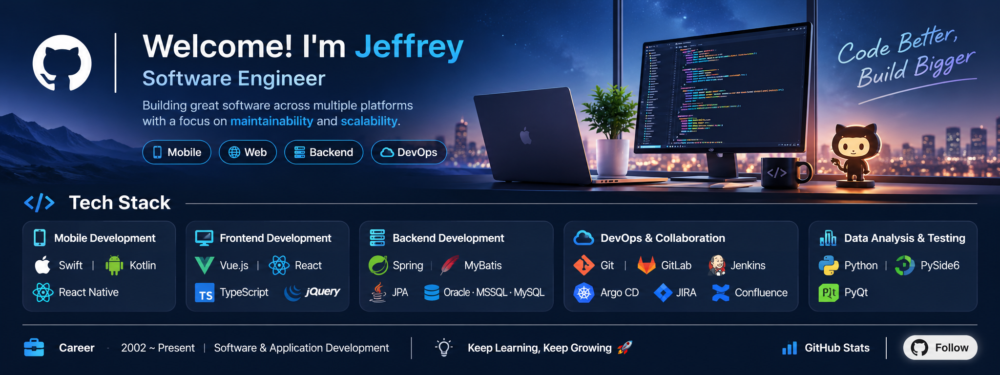

# 👋 Welcome! I'm Jeffrey

   
 

## Software Engineer
**Mobile · Web · Backend · DevOps**
> Building software across multiple platforms with a focus on maintainability and scalability. 

 

## 🛠 Tech Stack
📱 **Mobile Development**

 

🌐 **Cross-platform & Frontend**

 

⚙️ **Backend & Database**

  
  
   
  
   
    
  
   
  
 

🚀 **DevOps & Collaboration**

   
  
  
  
  
  
  
  
   
 

🧪 **Data Analysis & Testing**

  

📊 **GitHub Statistics**

## 💼 **Career**
| Type | Period | Description |
|:---:|:---:|:---:|
| Software Development | 2002 ~ Present | Software & Application Development |

# Webpack : migration v3 -> v4
`https://github.com/webpack/webpack-dev-server/blob/master/migration-v4.md`

# iOS Development 
## XCode Tips
- Xcode 가끔 빌드 에러 문제 발생 할때 ‘~/Library/Developer/Xcode/DerivedData’ 아래 폴더를 모두 삭제한다.

## Folder
- Classes
   + Core
   + Utilities
   + Controllers
   + Managers
   + Views
   + Models
   + ViewModels
   
- Resources
 + Asserts
 + XIBs
 + Storyboards

 ## AppLink Command
 - Android
   adb shell am start -a android.intent.action.VIEW -d "[scheme]://[host]?[key1=value1&key2=value2]"

 - iOS
   xcrun simctl openurl booted "[Scheme]://[URL identifier]?[key1=value1&key2=value2]"
 
 ## Coordinator 패턴 Folder
 MVVM 패턴에서는 위에 Folder구조를 추천 하지만, 개인적으로 비즈니스 폴더 아래에 모델, 뷰모델, 컨트롤러가 같이 있는게 구분하기 편한 것 같습니다.
 
 - Classes
   + Coordinator
     + Coordinators
   + Scenes
     + Business Folder
       + Model
       + ViewModel
       + Controller

## iOS OS 최소 지원 Version
`게임도 아니고 아직도 최소 지원 OS 버전을 9 또는 10 지원을 우기는 자들을 위한 지원 버전 참고`
- 2023년 기준 버전 15 이상 98%
- 2022년 기준 버전 14 이상 97%
- 카카오톡 : 2022년 11월 초부터 iOS 13.7 이하 버전 지원 중단
  

**iamjeffrey/iamjeffrey** is a ✨ _special_ ✨
repository because its `README.md` (this file) appears on your GitHub profile.

Here are some ideas to get you started:

- 📚 Useful Resources
- 🚀 
- 👨‍💻 About the Author
- 🔗 Connect 
- 🐙 GitHub, 💼 LinkedIn, 📧 Email
- 💬 Feedback
- ⭐ Thanks for Reading!
- 👏 Give it a clap
- 💬 Share your feedback
- 🔗 Share it with other developers and DevOps engineers
- ➕ Follow me for more DevOps, Cloud, GitHub, and automation content

- 🔭 I’m currently working on ...
- 🌱 I’m currently learning ...
- 👯 I’m looking to collaborate on ...
- 🤔 I’m looking for help with ...
- 💬 Ask me about ...
- 📫 How to reach me: ...
- 😄 Pronouns: ...
- ⚡ Fun fact: ...

